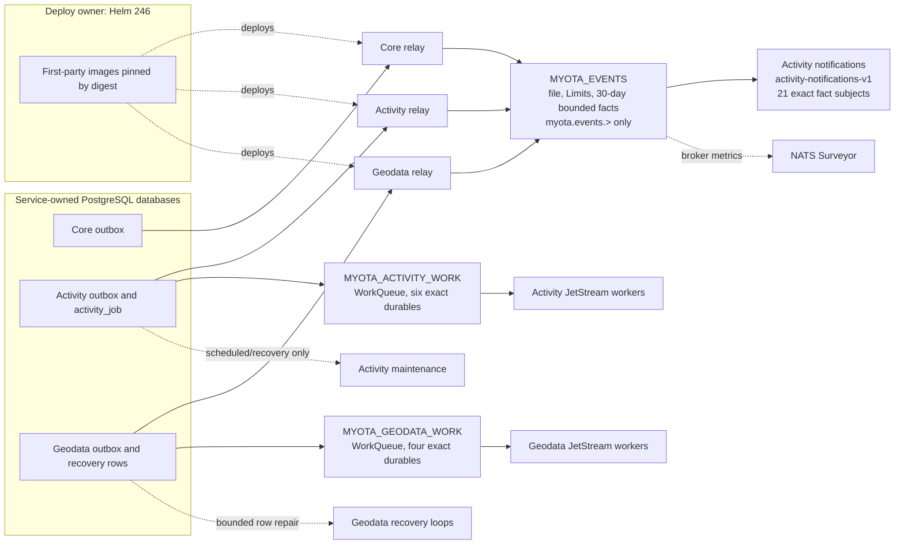
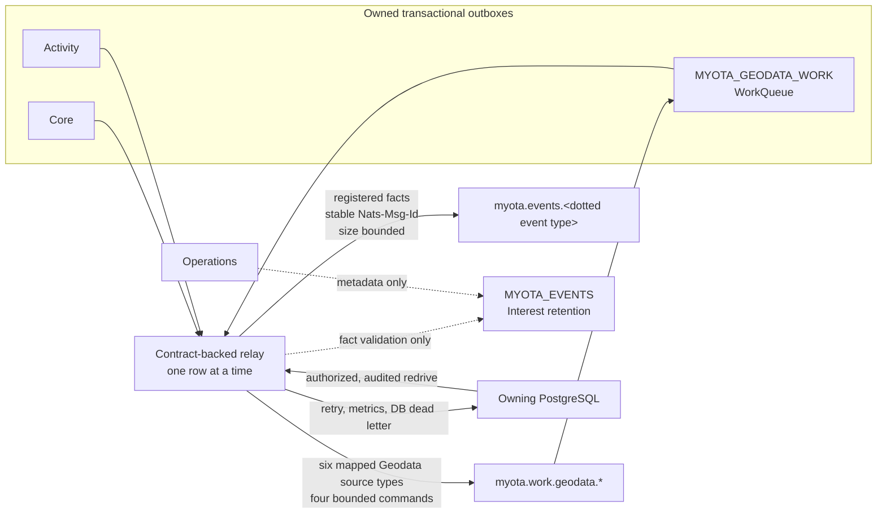
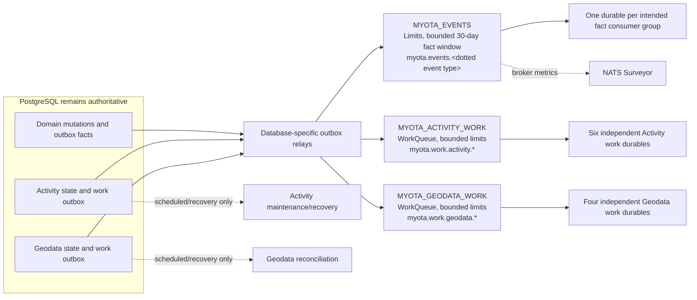

# NATS event and work topology

The diagrams distinguish historical rollout snapshots from the Phase 6
live topology. The lower current-state diagrams are grounded in the live
read-only K3s checks recorded in the
[Phase 6 evidence](../../operations/messaging/evidence/phase6-fact-stream-cutover-2026-10-11.md).
See the [migration plan](../../operations/messaging/nats-event-migration-plan.md),
[joint review](../../operations/messaging/evidence/phase1-joint-review-2026-10-10.md),
[Phase 1 evidence](../../operations/messaging/evidence/phase1-contract-topology-2026-10-09.md), and the [recovery runbook](../../operations/messaging/jetstream-recovery.md).

## Current deployed topology — Phase 6 cutover, Helm 246

The direct cutover changed `MYOTA_EVENTS` to Limits retention and removed
the legacy Geodata subject capture after an empty-stream preflight. Helm
revision 246 is deployed with the one-time migration flag disabled. The MyOTA
Fleet bundle is Ready=True with 67/67 resources at Deploy main commit
`f7d2e65edd5248d70376cf99ccc98c836b7f95e3`. The four legacy Geodata durables
retired during Phase 5 remain absent. Operations no longer connects to NATS;
Surveyor owns broker monitoring.

## Historical Phase 2 relay behavior — 10 October 2026

This is a historical snapshot from Phase 2. At that point, facts still
published to the Interest-retained shared stream while mapped work commands
published to their disjoint WorkQueue streams. The live Phase 6 topology is
shown above; do not use the historical Interest-retention annotation as current
configuration.

## Phase 4 Activity work — live in production

The production `MYOTA_ACTIVITY_WORK` stream uses WorkQueue retention and the
six exact pull durables. Two Activity workers subscribe to them; the obsolete
`activity_job_claim_idx` and synthetic `NOTIFICATION_SEND` jobs were retired by
migration 007. `activity_job` remains the status, history, and recovery source
of truth. The production backlog was zero at cutover, so live handler execution
is not claimed; isolated PostgreSQL/JetStream qualification processed all six
registered command types. See the [Phase 4 evidence](../../operations/messaging/evidence/phase4-activity-work-2026-10-10.md)
and [work queue runbook](../../operations/messaging/activity-work-queues.md).

## Selected topology — now live after Phase 6

**Historical Phase 5 snapshot (10 October 2026):** This view records Helm
revision 192 before the final Phase 5 durable retirement and Phase 6 cutover.
At that point, the legacy Geodata durables were awaiting retirement and
`MYOTA_EVENTS` still used Interest retention. Those states are superseded by
the current Phase 6 topology above. The accepted cluster-internal trust
boundary and deferred off-node recovery remain as recorded in ADR-0008. See the
[Phase 5 evidence](../../operations/messaging/evidence/phase5-geodata-work-2026-10-10.md),
[Phase 4 evidence](../../operations/messaging/evidence/phase4-activity-work-2026-10-10.md),
[Activity work queues runbook](../../operations/messaging/activity-work-queues.md),
and [Phase 3 evidence](../../operations/messaging/evidence/phase3-domain-consumers-2026-10-10.md).
