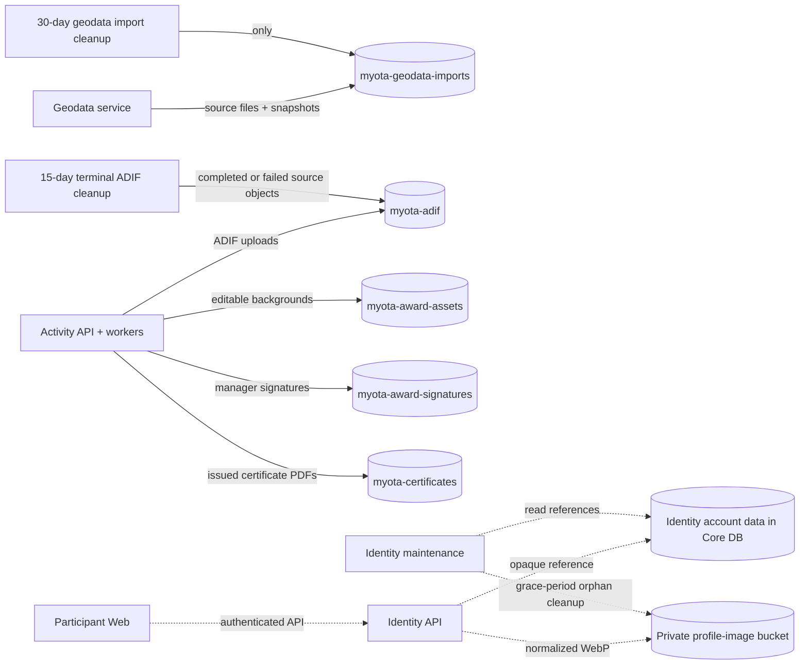

# Object-storage bucket boundaries

All buckets share one configured S3-compatible endpoint. Bucket names are
independently configurable in Compose and Helm. The separation is for purpose,
access, and lifecycle policy; it does not imply a separate SeaweedFS cluster per
bucket.

Background and signature bucket selection is server-side based on the asset
kind. Certificates remain durable issuance records and are never subject to
either import cleanup. ADIF cleanup deletes only source objects for completed
imports; import results remain in the activity database. Queued and processing
imports are excluded from the 15-day policy; both completed and failed imports
are eligible.

## Profile image flow

The profile flow is deployed and storage permissions were verified in the
isolated `myota-test` release; it has not been promoted to production. Identity
owns profile metadata and authorization; the dedicated SeaweedFS bucket holds
normalized private WebP objects. The existing service and volume are shared,
but the Testing bucket and credentials are isolated from production. See
[profile policy and operations](../../domain/identity/profile.md) for limits,
retention, backup constraints, credential rotation, and verification status.
