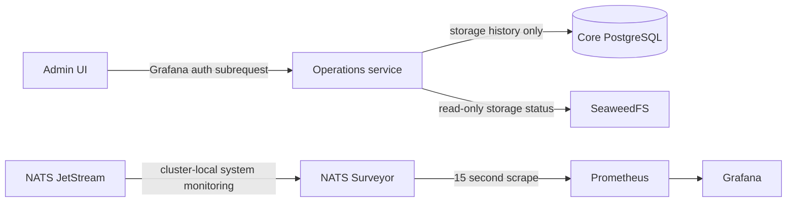

# Observability architecture

Operations no longer needs a NATS connection for broker metrics. Surveyor is
the central broker observer; its Service and NATS connection stay internal.
The eleven dashboards (dashboard 16256 plus ten pinned Surveyor dashboards)
are provisioned in Grafana folder `NATS`. Prometheus keeps 15 days of metrics,
not broker messages. The single-server deployment leaves cluster, gateway,
multi-node Raft, and optional service-observation panels without data.

**Implementation status (11 October 2026):** source retirement passed service
CI. Fleet is applying corrected capacity configuration after a failed NATS
config render was rolled back to the prior healthy release. The Admin,
Operations, and Geodata live image rollout and Operations history-table
migration remain open. See the [NATS monitoring roadmap](../../observability/nats-surveyor-migration.md).
