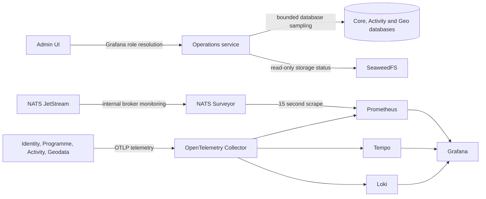

# Observability architecture

Surveyor owns NATS broker monitoring. Operations has no NATS connection; it
retains read-only storage status/history and Grafana role resolution. The
Operations snapshot table and index were retired by a forward migration;
storage history remains. Direct Collector PostgreSQL receivers remain disabled
after authentication failures. The active bounded database telemetry path and
remaining coverage gaps are documented in the
[logging roadmap](../../observability/logging-implementation.md).

Eleven dashboards (Grafana dashboard 16256 plus ten pinned Surveyor dashboards)
are provisioned in folder `NATS`. Prometheus retains 15 days of metrics, not
broker messages. Panels that require a multi-server cluster, gateway, or
multi-node Raft have no corresponding signals in this single-server deployment.

The latest read-only snapshot is [Helm 246, Fleet Ready with 67/67 resources,
and 23/23 MyOTA Deployments ready](../current-state.md). Remaining acceptance
gates include authenticated Grafana navigation, request-to-worker correlation,
Loki prohibited-field/cardinality review, Compose runtime parity, and
Identity/Programme metrics coverage. Readiness is not acceptance closure. See
[logging evidence](../../observability/evidence/logging-implementation-2026-10-11.md)
and [Surveyor cutover evidence](../../observability/evidence/2026-10-11-nats-surveyor-cutover.md).
