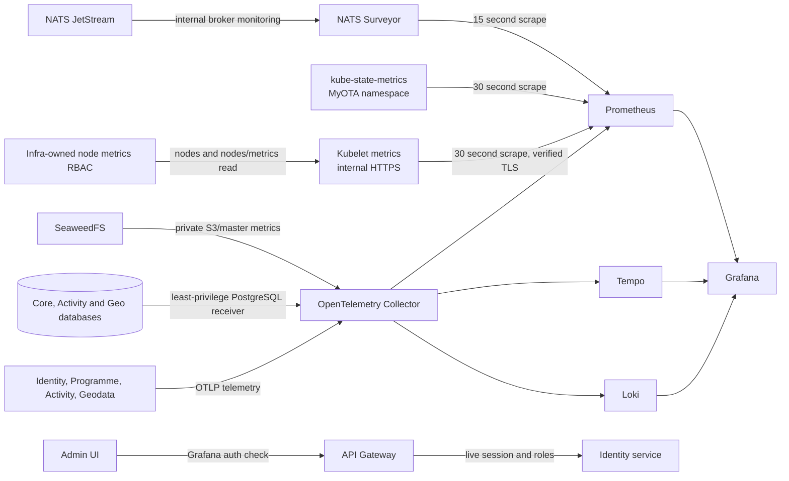

# Observability architecture

The dashboard configuration is owned by the `myota` monorepo under
`deploy/observability`; Helm packages its deployment copy from
`deploy/helm/myota`. kube-state-metrics is
restricted to the MyOTA namespace. Prometheus scrapes Kubelet resource and
volume metrics over internal HTTPS with projected credentials and CA
validation. Fleet keeps the cluster-scoped `nodes`/`nodes/metrics` read
permission in the infra-owned bundle; it is bound only to MyOTA Prometheus.
The Prometheus K3s scrape interval is 30 seconds and metrics are filtered to
the MyOTA namespace.

The K3s workload dashboard shows readiness, restart changes, HPA state,
resource usage versus requests, and PVC capacity. It is Helm-only because
Compose has no Kubernetes workload metrics. The application workflow dashboard
shows outbox, Activity and Geodata work, and supported broker metrics. Current
NATS Surveyor data does not provide per-durable pending, ack-pending,
redelivery, or oldest-message-age series; the dashboard discloses those gaps.
The PostgreSQL/PostGIS dashboard similarly identifies transaction-age, cache,
and vacuum/freeze measurements that are not collected. See the
[dashboard enhancement evidence](../../observability/evidence/dashboard-enhancements-2026-10-12.md).

Surveyor owns NATS broker monitoring. SeaweedFS telemetry flows through the
private Collector scrape to Prometheus and Grafana; Operations no longer
samples SeaweedFS or retains its history. The forward migration drops the
retired `operations_storage_snapshot` table and owned index. Operations is
retired. Direct Collector receivers collect bounded database metrics with
least-privilege credentials, while Gateway and Identity own Grafana
authorization. The active bounded database telemetry path and
remaining coverage gaps are documented in the
[logging roadmap](../../observability/logging-implementation.md).

Eleven NATS dashboards (Grafana dashboard 16256 plus ten pinned Surveyor
dashboards) are provisioned in folder `NATS`. Prometheus retains 15 days of
metrics, not broker messages. Panels that require a multi-server cluster,
gateway, or multi-node Raft have no corresponding signals in this single-server
deployment.

Testing Helm revision 301 has the provisioned logs and trace dashboards; the
current Testing release and query limits are recorded in the
[test deployment record](../../operations/test-deployment.md). Logging acceptance remains
open for authenticated Grafana navigation, request-to-worker correlation,
Loki privacy/cardinality review, Compose parity, and retention/recovery
evidence. Readiness is not acceptance closure. See
[logging evidence](../../observability/evidence/logging-implementation-2026-10-11.md)
and [Surveyor cutover evidence](../../observability/evidence/2026-10-11-nats-surveyor-cutover.md).
