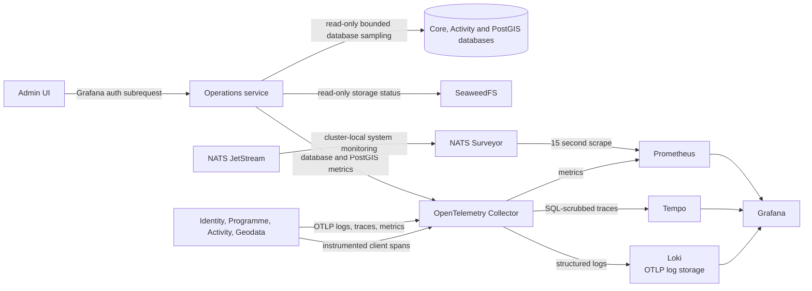

# Observability architecture

The active database path uses the Operations service's fixed-name, read-only
monitor adapter for PostgreSQL counters and bounded PostGIS extension
presence/version. Direct Collector PostgreSQL receivers remain disabled after
repeated authentication failure. Psycopg instrumentation disables parameter
capture and SQL commenter; Collector transforms remove SQL-bearing span
attributes before Tempo export. Raw PostgreSQL statement logs are not
collected because they can contain SQL literals and user data.

The logging source and images are deployed. Stable NATS correlation uses
`correlationId`, then `workId`, then `eventId` in the message header; consumer
logs inherit that context. The originating HTTP ID remains unavailable for
outbox rows that did not persist it. All Deployments currently report Ready,
but Helm revision 242 remains `pending-upgrade` while Fleet reports revision
241 Ready with 67/67 resources. Authenticated Grafana navigation, a live
request-to-worker correlation check, a Loki prohibited-field audit, and full
Compose runtime parity remain open. See the
[logging implementation plan](../../observability/logging-implementation.md)
and [current evidence](../../observability/evidence/logging-implementation-2026-10-11.md).

Operations no longer needs a NATS connection for broker metrics. Surveyor is
the central broker observer; its Service and NATS connection stay internal.
The eleven dashboards (dashboard 16256 plus ten pinned Surveyor dashboards)
are provisioned in Grafana folder `NATS`. Prometheus keeps 15 days of metrics,
not broker messages. The single-server deployment leaves cluster, gateway,
multi-node Raft, and optional service-observation panels without data. On
11 October, all thirteen adapted dashboard 16256 PromQL targets returned live
Grafana data frames without query errors; see the
[query evidence](../../observability/evidence/2026-10-11-nats-surveyor-cutover.md).

**Implementation status (11 October 2026):** Surveyor 0.9.11, the eleven NATS
folder dashboards, bounded JetStream capacities, and replacement Admin,
Operations, and Geodata images are live. Helm revision 208 applied the
Operations snapshot retirement migration; storage history remains. Fleet is
Ready=True on Deploy main commit `d0d2f50846fe2c9e239d46a48809860f4b98d7f5`
with 64/64 resources ready. The monitoring retirement phase is complete. See
the [NATS monitoring roadmap](../../observability/nats-surveyor-migration.md)
and [live evidence](../../observability/evidence/2026-10-11-nats-surveyor-cutover.md).
