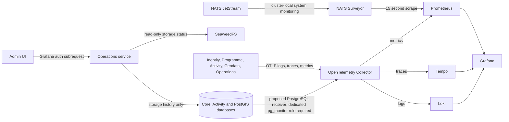

# Observability architecture

The current structured-logging rollout uses the existing Collector, Tempo, and
Prometheus plus Loki. Phase 1–5 source/configuration work is recorded, but
current service image digests and live request-to-worker correlation still need
acceptance. The PostgreSQL-to-Collector edge is **proposed** and remains disabled
until a dedicated read-only monitoring login and Phase 7 verification exist. See
the [logging implementation plan](../../observability/logging-implementation.md)
and [evidence](../../observability/evidence/logging-implementation-2026-10-11.md).

Operations no longer needs a NATS connection for broker metrics. Surveyor is
the central broker observer; its Service and NATS connection stay internal.
The eleven dashboards (dashboard 16256 plus ten pinned Surveyor dashboards)
are provisioned in Grafana folder `NATS`. Prometheus keeps 15 days of metrics,
not broker messages. The single-server deployment leaves cluster, gateway,
multi-node Raft, and optional service-observation panels without data. On
11 October, all thirteen adapted dashboard 16256 PromQL targets returned live
Grafana data frames without query errors; see the
[query evidence](../../observability/evidence/2026-10-11-nats-surveyor-cutover.md).

**Implementation status (11 October 2026):** Surveyor 0.9.11, the eleven NATS
folder dashboards, bounded JetStream capacities, and replacement Admin,
Operations, and Geodata images are live. Helm revision 208 applied the
Operations snapshot retirement migration; storage history remains. Fleet is
Ready=True on Deploy main commit `d0d2f50846fe2c9e239d46a48809860f4b98d7f5`
with 64/64 resources ready. The monitoring retirement phase is complete. See
the [NATS monitoring roadmap](../../observability/nats-surveyor-migration.md)
and [live evidence](../../observability/evidence/2026-10-11-nats-surveyor-cutover.md).
