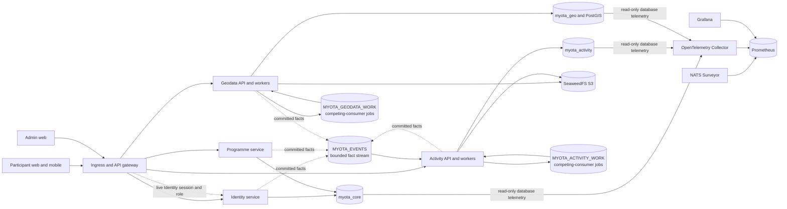

# MyOTA service and data ownership

This current-state view summarizes service boundaries. The admin web
coordinates APIs but does not own domain data. Cross-service references are
IDs, slugs, and versioned API/event payloads, never cross-database foreign keys.

The service/data-flow diagram below represents unchanged runtime boundaries.
Repository ownership is in transition: source snapshots are consolidated under
`myota/apps/*`, `myota/web/*`, and `myota/deploy`, but production and
Testing Fleet still track the split Deploy repository. The monorepo has not
been deployed. See the
[repository map](../repository-map.md) and
[dated transition evidence](../evidence/monorepo-transition-2026-10-14.md).

NATS is cluster-internal. Surveyor is the broker observer; Operations has no
NATS connection. Operations is retired. Deploy's Collector reads bounded database statistics, and Gateway checks current Identity session and role data before Grafana access. SeaweedFS monitoring flows from its
private metrics listener through the Collector to Prometheus and Grafana;
Operations does not sample storage or retain its history. PostgreSQL remains
authoritative for domain state, job state, outbox delivery, and recovery.

## Ownership

- Identity owns accounts, callsigns, authentication sessions, roles, scopes,
  and OIDC provider mappings.
- Programme owns programme metadata, policy versions, locale and jurisdiction
  configuration, and category catalogue/assignment APIs.
- Activity owns activations, QSOs, corrections, aggregates, award definitions,
  progress, issuance, and activity notifications.
- Geodata owns geometries, entity lifecycle, imports, provenance, conflation,
  review, and geodata audit history.
- Deploy owns Collector configuration; Gateway and Identity own Grafana
  session and role checks. The retired Operations repository was archived on
  2026-10-13. It no longer samples SeaweedFS and does not inspect or consume
  JetStream.
- The `myota` repository now contains candidate service code and deployment
  assets at `apps/*`, `web/*`, `contracts`, and `deploy`. This is not yet
  the deployed source. Fleet still reads Deploy's `main` and `testing` branches.
- Platform copies of Deploy assets remain synchronized transition mirrors.
  Compare and retire them only after monorepo deployment parity is verified.

For the latest live deployment revision and evidence limits, see
[Current system state](../current-state.md). The
[NATS diagram](nats-event-migration.md) distinguishes the current topology from
historical rollout snapshots.
