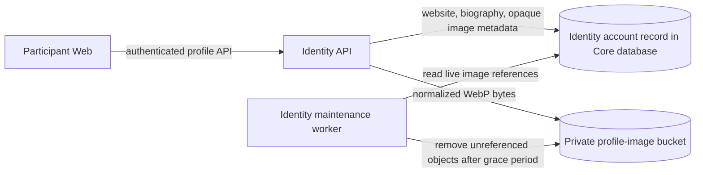

# Shared account profile fields and images

This page records the profile behavior implemented for MyOTA issue
[#55](https://github.com/myota-platform/myota/issues/55). Contracts, Identity,
deployment, and Participant Web changes merged to `testing` in PRs
[#76](https://github.com/myota-platform/myota/pull/76),
[#77](https://github.com/myota-platform/myota/pull/77),
[#78](https://github.com/myota-platform/myota/pull/78), and
[#79](https://github.com/myota-platform/myota/pull/79). The feature is deployed
in the isolated `myota-test` namespace. Production has not been changed.

## Ownership and data flow

Identity owns profile fields, authorization, image normalization, and the
opaque image reference. The account record remains in the Identity-owned Core
database's current `service_state` JSONB snapshot. SeaweedFS stores image bytes
in a separate private bucket for each environment. Participant Web calls
Identity with the user's bearer token; it does not communicate with SeaweedFS
directly.

This path is implemented and storage permissions were verified in isolated
Testing. It has not been promoted to production. The image object key and
bucket name are never returned to a browser or stored in client configuration.

## Fields and validation

| Field | Constraint | Privacy and rendering |
|---|---|---|
| `websiteUrl` | Optional; at most 2,048 characters; HTTP or HTTPS only; reject credentials, control characters, whitespace, and malformed authorities. `null` or an empty string clears it. | Returned only by authenticated Identity account operations. The client must use an escaped link and `rel="noopener noreferrer"`; Identity does not fetch the URL. |
| `biographyMarkdown` | Optional Markdown source; at most 2,000 characters. `null` or an empty string clears it. | Private by default. Participant Web escapes source text, strips raw HTML by never interpreting it, and allows only sanitized HTTP(S) links in its small Markdown subset. |
| `profileImage` | Server-managed metadata only: opaque UUID, `image/webp`, 512 × 512, and update time. | No bucket, key, permanent URL, or storage credential is exposed. The field is `null` when no image is set. |

Old Identity account records may lack all three keys. They are read as `null`;
this change does not require a destructive database migration or alter account
identity. A future relational Identity schema must add nullable fields and
preserve the same API semantics.

## Image upload and access

The API is described in the
[OpenAPI contract on `testing`](https://github.com/myota-platform/myota/blob/testing/contracts/openapi.yaml):

- `PATCH /v1/identity/me/profile` updates only the caller's website and
  biography.
- `PUT /v1/identity/me/profile-image` accepts raw JPEG, PNG, or WebP bytes;
  multipart and SVG uploads are not accepted.
- `GET` and `DELETE /v1/identity/me/profile-image` read or remove the caller's
  image.
- `GET /v1/identity/accounts/{accountId}/profile-image` is restricted to the
  account owner or an Identity administrator.

Identity enforces a 5 MiB input limit and a maximum input dimension of 4,096
pixels per side. It verifies decoded content against the media type, rejects
animated or malformed images and decompression bombs, applies EXIF orientation,
then crops and re-encodes a square 512 × 512 WebP rendition. The output limit
is 256 KiB. Source metadata, including EXIF location fields, is removed.
Participant Web repeats basic type, size, and dimension checks for usability;
server-side checks remain authoritative.

Image reads return authenticated bytes with `Cache-Control: private, no-store`.
The bucket has no public ACL or anonymous identity. Only the Identity API and
its maintenance worker receive the separate profile-image credentials; they
are scoped to that environment's profile bucket. The SeaweedFS process also
retains its existing storage-admin identity for other bucket provisioning and
services.

## Replacement, removal, and retention

Identity writes a new object under a server-generated key, persists the new
opaque reference, and then attempts to delete the previous object. If metadata
cannot be persisted, Identity rolls back the reference and attempts to delete
the new upload. Explicit image removal and anonymized account deactivation
clear Identity metadata before deleting the object. Anonymization also clears
website and biography fields. Deactivation without anonymization retains the
profile under the existing account-retention policy.

Identity maintenance scans only the `profiles/` prefix in the configured
profile bucket. It deletes unreferenced WebP objects after a 24-hour grace
period by default (the configured minimum is one hour), which covers failed
deletes and interrupted uploads. It does not expire referenced profile images.
The job runs at the configured Identity maintenance interval, one hour by
default. Failures are logged as a job warning without logging account IDs,
object keys, or image content.

## Deployment and operations

Compose and Helm provision one private profile-image bucket per environment.
The Testing release uses bucket `myota-test-user-profile-images`, credential
Secret `myota-test-profile-image-s3-auth`, and static S3 configuration Secret
`myota-test-seaweedfs-s3-config`; production must use separately generated
runtime credentials and its own bucket. Keep both the profile credentials and
SeaweedFS static S3 config in Kubernetes Secrets or the local Compose
environment. Never commit their values, put them in a ConfigMap, or print them
in CI output. SeaweedFS reads the static config at startup, so a credential
rotation updates the Identity Secret and the matching SeaweedFS config
together, then restarts SeaweedFS and the Identity API/maintenance workloads.
The isolated Testing release passed authorized object write/read/delete,
unrelated-bucket denial, and anonymous bucket-list denial checks.

The dedicated bucket shares the existing SeaweedFS service and storage volume;
it is not an independent storage cluster or capacity boundary. The 512 × 512
rendition is capped at 256 KiB, so the theoretical image-only upper bounds are
about 250 MiB per 1,000 profiles, 2.44 GiB per 10,000, and 24.4 GiB per
100,000 profiles. Actual averages should be measured before raising account or
upload limits. Test SeaweedFS currently uses a 20 GiB PVC. The shared volume
has no per-bucket quota in this change, so monitor its free capacity and
revisit the limit before the expected profile count approaches the available
storage.

SeaweedFS data and Identity metadata must be restored to a mutually consistent
point: restore the Identity database snapshot and the SeaweedFS volume from
compatible recovery points, then verify that every non-null profile reference
can be read and that no restored object is exposed anonymously. Current
single-node deployment documentation does not establish off-node recovery or
a qualified end-to-end restore for this new bucket. Do not describe the bucket
as independently backed up until such evidence exists. No production bucket,
credential, or live profile data was changed for this work. Testing
qualification used a temporary object in the dedicated Test bucket and
removed it after verification.

## Backup, restore, and credential rotation procedure

The recovery unit is Identity metadata plus the shared SeaweedFS volume, not
just the profile bucket. This is an operator procedure; no backup or restore
was performed as part of the profile acceptance check. Existing local backups
do not establish off-node recovery.

1. Choose an environment and a maintenance window. Record the deployed image
   digests, Helm values, replica counts, database recovery point, and volume
   identity. Block profile writes and pause Identity maintenance/orphan cleanup
   before capturing either side of the metadata/object relationship. Quiesce
   other writers to the shared SeaweedFS volume before taking a filesystem
   archive; a live file copy is not a consistent SeaweedFS backup.
2. Capture the Core database with the established PostgreSQL backup procedure
   and capture the complete SeaweedFS persistent volume, including its filer
   metadata, while its writers are stopped. Keep both artifacts under the same
   recovery record. Preserve runtime credentials and S3 configuration in the
   operator's protected secret backup; do not put them in the database dump,
   Git, an issue, or an evidence page. Record artifact checksums and restrictive
   file permissions. Resume only the recorded workloads after capture.
3. Restore into an isolated recovery namespace and empty recovery volumes
   first. Restore the compatible Core and SeaweedFS artifacts and provision
   environment-specific Secrets. Keep Identity maintenance paused until the
   restored account references have been checked. Do not connect the recovery
   API to production storage or copy its credential into a browser.
4. For every non-null profile reference, confirm the corresponding object can
   be read by the Identity storage identity and is a valid bounded WebP image.
   Verify anonymous and unrelated-bucket access denial. A missing object is a
   recovery discrepancy: restore it from the matching storage backup or clear
   its reference through the authorized Identity API after recording the
   decision. Do not silently claim recovery or delete unfamiliar objects.
5. Verify profile fields and authorized API image reads using a disposable
   recovery account. Remove its media and confirm inventory cleanup before
   enabling orphan cleanup. Cut over only after database and storage evidence
   agree; retain the previous recovery pair until that decision is complete.

For credential rotation, generate a new scoped credential in the runtime
secret store, update both the Identity profile Secret and SeaweedFS static S3
configuration Secret for the same environment, then roll SeaweedFS followed by
Identity and its maintenance worker. Verify scoped read/write/delete and
cross-bucket denial with a disposable object. If verification fails, restore
the matching previous pair and roll both workloads; never restore only one
side. Rotation changes authentication, not object keys or account references.

The existing 20 GiB Test PVC is shared with other buckets. Keep at least 20%
free for ongoing storage operations and stop increasing profile capacity before
that reserve is consumed. This is a conservative operational reserve, not a
measured capacity qualification. The per-image and aggregate size estimates
above remain the documented capacity boundary; referenced images do not expire.

## Source ownership

The monorepo is authoritative. `apps/identity/` owns account behavior and the
image store; `contracts/openapi.yaml` owns the API contract;
`web/participant/` owns the browser editor; and `deploy/` owns Compose, Helm,
bucket initialization, and S3 configuration. `deploy/services/identity.py`,
`deploy/services/identity_maintenance.py`, and
`deploy/services/profile_images.py` are synchronized deployment copies of the
Identity implementation and must remain in parity. `deploy/services/common.py`
is a broader, independently maintained deployment runtime; it is not a byte-
for-byte copy of Identity common. Its profile upload limits and binary response
behavior must remain compatible, as checked by the deployment tests. The implementation is in
`apps/identity/`, `contracts/`, `web/participant/`, and `deploy/`; the
corresponding changes are linked from the merged PRs above.
The Testing Fleet source uses the monorepo. Production Fleet still points to
`myota-platform/myota-deploy` on `main`, and the legacy `myota-platform` and
`myota-deploy` repositories remain unarchived. This profile feature has not
been promoted to production. Reconcile the legacy deployment path as part of
the production cutover before promoting or retiring these repositories.

## Verification status

Identity (35 tests), Contracts (12 tests plus generated-client checks), Deploy
(85 tests), Participant utility/static tests (4/4 each), and all required PR
checks passed. The Participant DOM suite added by PR #77 passed 7/7. Testing
uses the immutable Identity and Web images recorded in the merged digest PR
[#78](https://github.com/myota-platform/myota/pull/78).

The live S3 qualification in `myota-test` passed authorized write/read/delete,
denied access to the unrelated `myota-adif` bucket, and denied anonymous
bucket listing. The temporary object was absent after cleanup, and the
qualification Jobs were deleted. The first attempt exposed a mismatch between
the profile credential's scoped bucket and the Testing chart's default; PR #79
corrected the Testing bucket value. The chart was applied from the merged
Testing source as Helm revision 321, with all Deployments ready. Fleet's
BundleDeployment still reports `ErrApplied` because its previous Helm release
reference points to missing revision 317; this is tracked separately in
[myota #53](https://github.com/myota-platform/myota/issues/53). The live Helm
release is deployed at the intended Testing values, but Fleet's status has not
yet recovered.

The Participant DOM tests use a mocked Identity API; no interactive browser
session against an existing account was used, to avoid leaving profile changes
on a copied user. The service tests cover the authenticated profile API,
normalization, authorization, replacement, and cleanup. See
[myota #9](https://github.com/myota-platform/myota/issues/9),
[#11](https://github.com/myota-platform/myota/issues/11),
[#12](https://github.com/myota-platform/myota/issues/12), and
[#13](https://github.com/myota-platform/myota/issues/13).

## Final Testing acceptance

The remaining deployment documentation and active mirror gates were verified
on 14 October 2026. The three mirrored Identity profile modules matched their
owners. Six focused deployment storage tests passed. An isolated Job using the
currently deployed Identity image exercised the real HTTP profile API against
the Test SeaweedFS bucket with runtime Secret references and an in-memory
synthetic account. It verified fields, normalization, authenticated reads,
replacement/deletion, and access denial without changing live accounts.

The profile bucket contained zero objects before and after the check. The
fixture and its Job/ConfigMap were removed. This closes the profile workstream's
Testing scope; production promotion and the monorepo Fleet transition remain
separate work. The authenticated browser editor is covered by the seven DOM
tests; the live qualification covers the service-to-storage path, not a browser
session. Exact evidence and limits are in the
[profile deployment closeout](../../operations/storage/evidence/profile-deployment-closeout-2026-10-14.md).
