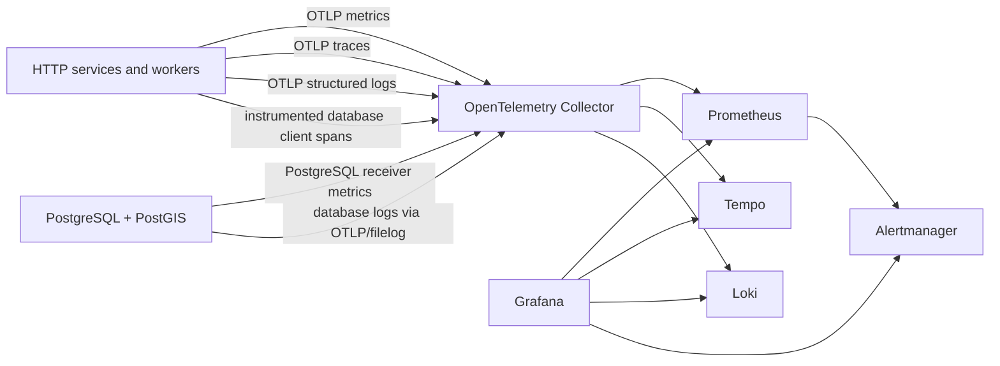
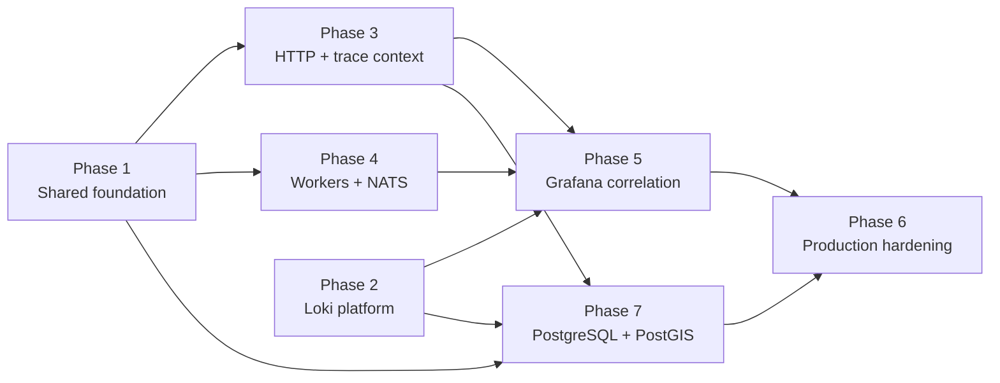

Status: Shared structured logging and bounded request-to-worker correlation
are implemented and deployed. All four producer-owned correlation issues are
closed with live evidence. As of 12 October 2026 07:56 UTC, Helm revision 281
is `deployed`; Prometheus and Grafana are 1/1, all 23 Deployments / 27 replicas
are ready, and the MyOTA Fleet GitRepo is Ready at Deploy commit `9d80741`; the
BundleDeployment is Ready at sync generation 94/94 with matching staged/applied IDs.

The 33 Prometheus alerts load with runbook URLs, Grafana mounts two alert
runbook links and three Logs / Failures dashboard links, and dashboard
provisioning completed. Deploy issue #6 remains open for three unverified
gates in the original evidence. Authenticated Grafana trace/log navigation
now passes in Testing after PRs #84/#85. Full Compose runtime/restart and
representative capacity/recovery qualification remain open. See the
[15 October browser evidence](evidence/grafana-browser-qualification-2026-10-15.md)
for the superseding navigation result. See the
[12 October evidence](evidence/logging-implementation-2026-10-12.md).

**Acceptance boundary:** checked deliverables below mean that their focused
source, CI, or live checks passed. They do not close remaining end-to-end
acceptance gates unless the linked evidence says so.

## Objective

Add durable, structured, correlated application and worker logging to the existing
Prometheus + Tempo + Grafana + OpenTelemetry Collector stack without introducing
a second observability control plane.

The target architecture is:



MyOTA will use **Grafana Loki** as the log backend and the existing
**OpenTelemetry Collector** as the ingestion and processing layer. Promtail,
Filebeat, Fluent Bit, Elasticsearch, and OpenSearch are intentionally not part of
the first implementation.

## Design principles

1. Logs are structured telemetry, not unbounded `print()` output.
2. All services use the same resource identity and field semantics.
3. `trace_id`, `span_id`, `request_id`, and `correlation_id` have distinct purposes.
4. HTTP route labels use normalized route templates; identifiers never become metric
   or Loki labels.
5. Worker and NATS/JetStream operations are first-class observability subjects.
6. Payloads and secrets are not logged by default.
7. Metrics remain the primary source for rate, latency, availability, and queue alerts;
   logs are used for investigation and exceptional-event alerts.
8. Compose and Helm must remain functionally aligned.
9. Prefer direct OpenTelemetry collection/instrumentation for PostgreSQL and
   PostGIS telemetry; using least-privilege database roles. Keep authentication and authorization at service boundaries.

## Correlation model

| Identifier | Scope | Purpose |
|---|---|---|
| `trace_id` | distributed execution path | OpenTelemetry trace correlation |
| `span_id` | one trace operation | link a log record to a specific span |
| `request_id` | one HTTP request | request/response troubleshooting |
| `correlation_id` | business/process workflow | correlate work across separate traces, queues and retries |
| `event_id` | one domain/message event | identify an emitted or consumed event |
| `job_id` | asynchronous job | follow job lifecycle and retries |

A single workflow may contain several traces while retaining one
`correlation_id`. For example an ADIF upload, JetStream processing, award
recalculation, and notification can remain queryable as one business operation
even if execution crosses asynchronous boundaries.

## Canonical structured log fields

Every application log record should support the following baseline fields:

```text
timestamp
severity
service.name
service.namespace = myota
service.instance.id
deployment.environment
component
event
trace_id
span_id
request_id
correlation_id
```

Context-specific fields may include:

```text
http.request.method
http.route
http.response.status_code
duration_ms

messaging.system
messaging.destination
messaging.message.id
messaging.operation
messaging.delivery_count

job.type
job.id
event.type
event.id

operator.id
programme.id
entity.id
import.id
activation.id
qso.id
award.id
```

Identifiers are fields/structured metadata, not Loki index labels.

## Loki label policy

Keep Loki labels deliberately low-cardinality. Initial labels should be limited to:

```text
service_name
service_namespace
deployment_environment
severity
component
```

A bounded `job_type` label may be added after validating cardinality.

Do **not** label on request IDs, trace IDs, correlation IDs, callsigns, operators,
entities, QSOs, imports, activations, programmes, awards, URLs, or arbitrary
exception messages.

## Data-handling policy

Do not log complete request/event payloads by default.

Explicitly exclude:

- Authorization headers and bearer tokens.
- JWTs, passwords, signing keys, S3 credentials, API keys and connection strings.
- Uploaded ADIF contents.
- GeoJSON/KML/GPX/WFS/ArcGIS bodies or complete geometries.
- Full user profiles or unrestricted personally identifying fields.
- Raw exception objects when they may embed credentials or payload fragments.
- Raw SQL literals, bind parameters, credentials, or unbounded query text in
  database spans, logs, metric labels, or diagnostic endpoints.

Prefer identifiers and bounded metadata such as import ID, feature count, source
type, object size, job type, delivery attempt, duration, result status, and
sanitized error classification.

## Retention baseline

Initial production target:

| Signal | Initial retention |
|---|---:|
| Prometheus | existing 15 days |
| Tempo | 7-14 days, capacity dependent |
| Loki | 14 days |
| DEBUG logs | disabled in production by default |

Loki retention is 14 days and is enforced by Loki's compactor. Loki's durable
TSDB index and chunks live in the dedicated SeaweedFS S3 bucket `myota-loki`,
using the existing SeaweedFS endpoint and S3 credential provisioning patterns.
Keep only a small local writable volume for active TSDB/WAL/index/cache and
compactor working data; it is not the authoritative log store. Do not provision
a 10-20 GiB Loki data PV. Do not add a separate MyOTA or SeaweedFS cleanup worker:
Loki's compactor owns expiration and deletion of retained log objects. Longer
WARN/ERROR retention may be considered later, but the first implementation
should keep one simple policy.

## Implementation phases

### Phase 1 - Shared structured logging foundation

Create a common MyOTA observability/logging helper and standardize resource
identity, severity, field names, redaction rules, and trace/span enrichment across
services.

Deliverables:

- [x] shared logging configuration;
- [x] JSON/structured log records;
- [x] OpenTelemetry logging provider/handler;
- [x] stable field names and resource attributes;
- [x] trace/span context enrichment;
- [x] tests for redaction and correlation fields;
- [x] removal of duplicated logging setup where practical.

Implementation prompt:
[Phase 1 ChatGPT prompt](prompts/logging-phase-1-shared-foundation.md)

### Phase 2 - Loki, collector pipeline, Compose and Helm

Add Loki in single-binary mode, store its durable TSDB index and chunks in the
dedicated SeaweedFS S3 bucket `myota-loki`, and connect the existing OTel logs
pipeline to Loki through OTLP. Keep Compose and Helm behavior aligned. Reuse the
SeaweedFS endpoint, bucket provisioning, and S3 credential/Secret patterns
already used by MyOTA.

Deliverables:

- [x] Loki TSDB and SeaweedFS S3 configuration for bucket `myota-loki`;
- [x] Compose observability service and a small local writable working volume;
- [x] Helm Loki workload/service and a small local writable working volume, without
  a 10-20 GiB Loki data PV;
- [x] local working storage limited to active TSDB/WAL/index/cache and compactor
  working data; object storage is the durable store;
- [x] OTel Collector Loki exporter path;
- [x] Grafana Loki datasource provisioning;
- [x] configurable 14-day Loki retention, enforced by the Loki compactor;
- [x] no separate MyOTA or SeaweedFS cleanup worker or object-store lifecycle policy
  for Loki retention;
- [x] Focused OTLP-to-Loki smoke check and SeaweedFS configuration check.
- [ ] Restart, retention-expiry, and full Compose/Helm parity acceptance checks.

Implementation prompt:
[Phase 2 ChatGPT prompt](prompts/logging-phase-2-loki-platform.md)

### Phase 3 - HTTP request logging and distributed trace propagation

Instrument the common HTTP path with completion logs for failed requests only
(4xx and 5xx), alongside proper W3C trace-context extraction/injection. Successful
requests remain visible in metrics and traces without a completion log.

Deliverables:

- [x] `http.request.completed` events;
- [x] normalized route, method, status and duration;
- [x] request/correlation IDs in logs and responses;
- [x] W3C `traceparent` / `tracestate` handling;
- [x] consistent server spans rather than isolated manual spans;
- [x] error classification without leaking request bodies;
- [x] tests confirming no completion log for 2xx, logs for 4xx/5xx, and
  propagated trace context;
- [x] live Identity `/healthz` request produced a matching Loki log record and Tempo trace.

Implementation prompt:
[Phase 3 ChatGPT prompt](prompts/logging-phase-3-http-tracing.md)

### Phase 4 - Workers, NATS/JetStream and asynchronous correlation

Add structured lifecycle logs to asynchronous components and propagate
correlation/trace metadata through messages.

Target components include:

- `activity-worker`;
- `activity-notifications`;
- `activity-adif-retention`;
- `geodata-import-processing`;
- `geodata-import-retention`;
- `identity-maintenance`;
- `outbox-core`;
- `outbox-activity`;
- `outbox-geo`.

Standard worker events:

```text
job.received
job.started
job.completed
job.retry
job.failed
```

Standard messaging fields should include `messaging.system=nats`, destination,
message/event ID, operation, and delivery attempt where available.

Deliverables:
- [x] lifecycle logs for Activity work and notification consumers;
- [x] lifecycle logs for Geodata import processing;
- [x] lifecycle logs for Identity maintenance and Deploy outbox relay;
- [x] NATS consumer/producer spans and W3C header propagation helpers, with
  focused helper tests;
- [x] Activity ADIF retention lifecycle logs;
- [x] Geodata import-retention source-owner coverage and validation: the
  authoritative worker and retention implementation are in
  `myota-geodata-service/geodata_retention_worker.py` and
  `myota-geodata-service/import_retention.py`; focused tests and the scheduled
  deployed job succeeded.
- [x] Deployed-worker retry/ACK and request-to-worker correlation acceptance.
  Identity, Programme, Activity, and Geodata owner paths were exercised live;
  Activity and Geodata work completed with matching correlation in Loki and
  advanced their durable ACK floors. Programme facts have no consumer group,
  so a worker ACK is not applicable. See the
  [12 October evidence](evidence/logging-implementation-2026-10-12.md) and
  linked service issue completion comments.
- [x] Stable NATS correlation header source for work/fact events: the relay
  selects `correlationId`, then `workId`, then `eventId`, and consumer log
  context inherits `Myota-Correlation-Id`. Focused CI and deployed
  request-to-worker checks pass.

Implementation prompt:
[Phase 4 ChatGPT prompt](prompts/logging-phase-4-workers-nats.md)

### Phase 5 - Grafana log exploration and metrics/traces/logs correlation

Turn Loki into a first-class Grafana datasource and connect all three observability
signals.

Deliverables:

- [x] Loki datasource in Compose and Helm provisioning;
- [x] Loki derived field linking `trace_id` to Tempo;
- [x] Tempo trace-to-logs configuration;
- [x] service/environment/severity/component filters;
- [x] a MyOTA Logs / Failures dashboard;
- [x] panels for errors by service, recent failures, worker failures/retries and HTTP
  server-error logs;
- [x] Links from API, workflow, and Geodata capacity dashboards to Logs / Failures are mounted and provisioned in Grafana.
- [x] verify Helm ConfigMap mounting and Grafana provisioning of the dashboard;
- [x] execute all seven mounted dashboard LogQL queries against live Loki OTLP
  structured metadata (no JSON parser);
- [x] Verify authenticated Grafana UI trace/log navigation in both directions.
  PRs #84/#85 corrected provisioning and metadata queries; the authorized Test
  browser check verified the matching record in the new reverse pane. See the
  [browser evidence](evidence/grafana-browser-qualification-2026-10-15.md).

Implementation prompt:
[Phase 5 ChatGPT prompt](prompts/logging-phase-5-grafana-correlation.md)

### Phase 6 - Production hardening, retention, alerts and verification

Finalize privacy controls, bounded cardinality, retention, runbooks and a small set
of log-specific alerts.

Use Prometheus for conditions already represented as metrics. Loki alerts should be
reserved for discrete exceptional events such as:

- database migration failure;
- permanent object-retention failure;
- JetStream maximum-delivery exhaustion;
- award rendering failure;
- unexpected authentication/signing failure.

Deliverables:

- [x] production 14-day Loki compactor retention configuration;
- [x] storage sizing/measurement procedure in the [runbook](logging-runbook.md);
- [x] Initial ingestion and object-store size measured; conservative capacity
  thresholds are documented with sample duration and limitations. The short
  pre-live sample is not represented as a production growth rate.
- [x] live Loki label-name check found only `deployment_environment`,
  `service_name`, and `service_namespace`;
- [x] Current Loki indexed-label and sampled payload-field audit: three fixed indexed labels; sampled records contain no request/domain payload.
- [ ] Cardinality under representative production traffic; current single-node traffic is not representative.
- [x] source redaction/correlation tests pass in service CI;
- [x] Live redaction check against Collector-to-Loki records: a synthetic path marker was absent from the normalized error log and no request body was recorded.
- [x] Bounded metric-backed alerts and operator runbook links are loaded: 33 Prometheus rules validate with `promtool`, and Grafana mounts two alert runbook links.
- [ ] Add log-only exceptional-event rules only where no equivalent metric exists and an actionable signal is established; avoid duplicate metric alerts.
- [x] initial operational queries and troubleshooting runbook in
  [logging-runbook.md](logging-runbook.md);
- [x] Live Loki ingestion and active 14-day retention policy/compactor activity verified.
- [ ] Representative capacity/recovery qualification and authenticated UI trace/log navigation; no such claim is made from the single-node sample.
- [ ] Compose/Helm parity check;
- [ ] Authenticated request -> trace -> log -> async worker navigation in Grafana. Worker request correlation is verified in Phase 4; interactive trace/log navigation remains open.

Implementation prompt:
[Phase 6 ChatGPT prompt](prompts/logging-phase-6-production-hardening.md)

### Phase 7 - PostgreSQL and PostGIS database observability

**Status:** Complete on 11 October 2026. The Deploy-owned Collector reads
bounded health metrics from Core, Activity, and Geo through separate
least-privilege roles. DB images do not enable TLS, so traffic remains
cluster-internal plaintext. Query samples, top queries, raw statement logs,
and high-cardinality database measurements remain disabled.

- [x] Database-scoped monitor roles have catalog-only grants.
- [x] Trailing newlines were removed from monitor credentials, PostgreSQL
  roles synchronized, and Collector restarted.
- [x] Non-empty backend, database-size, commits, rollbacks, and deadlock
  series were verified for all DBs; authentication failures stopped.
- [x] Operations sampler, routes, workload, image reference, and snapshot
  tables are retired; Activity and Geo have no Operations tables.
- [x] Gateway's internal `/_internal/grafana/auth` checks live Identity
  sessions/roles; unauthenticated requests return 401 and `no-store`.
- [x] Database spans are scrubbed of SQL statements, query text, and parameters.
- [x] Dashboards use live Collector metrics and disclose unavailable
  transaction-age, cache, and vacuum/freeze measurements.

Helm 0.2.20 revision 272 is deployed; Fleet is Ready with 23 Deployments and
27 replicas. Compose source removes Operations and has static checks; runtime
Compose could not be tested because Docker/Podman are not installed.

See [retirement evidence](../operations/evidence/operations-service-retirement-2026-10-11.md)
and [Deploy issue #9](https://github.com/myota-platform/myota-deploy/issues/9).

Implementation prompt:
[Phase 7 prompt](prompts/logging-phase-7-database-observability.md)

## Phase dependencies



Phases 1 and 2 may proceed in parallel. Phase 3 and Phase 4 depend on the common
semantics from Phase 1. Phase 5 requires Loki plus instrumented data. Phase 7
requires the Collector path from Phase 2 and database client instrumentation
from Phase 3. Phase 6 is the final production gate after Phases 5 and 7.

## Definition of done

Logging is considered implemented when:

1. Every production HTTP service and asynchronous worker emits structured logs.
2. Production logs reach Loki through the OTel Collector.
3. Compose and Helm expose equivalent logging capability.
4. Grafana can navigate from a log to its Tempo trace and from a trace to related logs.
5. A `correlation_id` can reconstruct a multi-service asynchronous workflow.
6. High-cardinality identifiers are queryable fields but not Loki labels.
7. Secrets and configured sensitive payload classes are demonstrably excluded.
8. Loki storage/retention is bounded and documented.
9. Existing Prometheus alert ownership is not duplicated by unnecessary log alerts.
10. Operational documentation includes troubleshooting queries and failure-mode guidance.
11. PostgreSQL health/workload metrics, database client traces, and safe database
    logs are visible through the existing OpenTelemetry/Grafana stack.
12. PostGIS-specific signals are covered directly where supported; otherwise the
    operations service exposes them through the existing telemetry path.

## 15 October 2026 — Browser qualification corrections

Authenticated Chromium inspection of Test Grafana exposed hidden application
logs and an empty **View trace** query. PR
[#84](https://github.com/myota-platform/myota/pull/84) corrects the application
namespace filter, includes the observed `test` environment and `WARN` severity,
uses `severity_text` grouping, and escapes the datasource trace macro during
provisioning. Fourteen focused source/provisioning tests pass. PR #84 merged after all CI checks passed, its corrected files are mounted,
and authenticated log-to-trace navigation succeeds. Reverse navigation still
uses a body search instead of a structured-metadata predicate; full Compose
dashboard-set/runtime parity and capacity/recovery remain open. The
bidirectional roadmap checkbox is unchanged. See the
[browser evidence](evidence/grafana-browser-qualification-2026-10-15.md).

## 15 October 2026 — Reverse navigation verified

PR [#85](https://github.com/myota-platform/myota/pull/85) fixes Tempo-to-Loki
structured-metadata filtering and adds the two missing Compose dashboards.
All 21 dashboard definitions match recursively; sixteen focused checks and all
PR checks pass. Grafana mounts the corrected datasource, and the authorized
browser verified both directions using an existing retained Identity error.
Source parity does not replace the full Compose runtime/restart gate.
