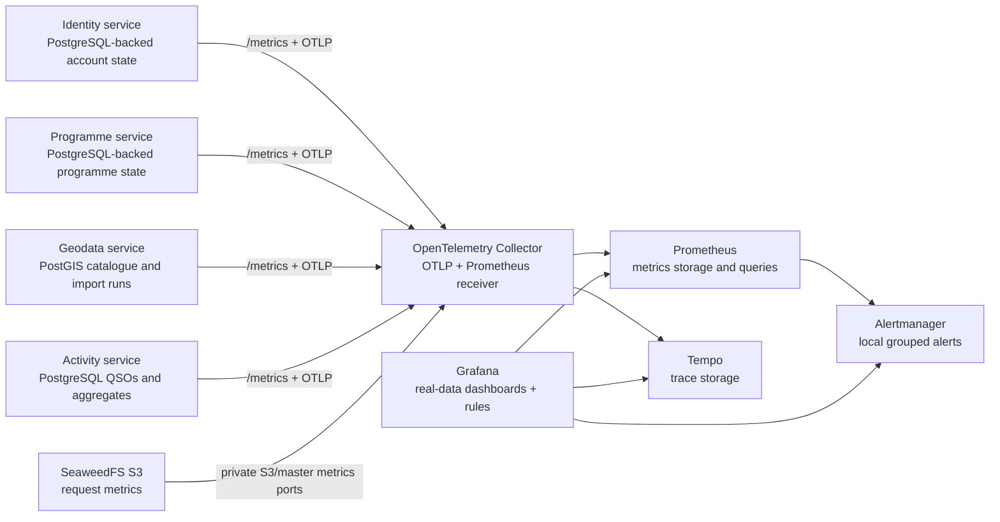

# MyOTA observability

For the latest deployment and repository snapshot, see the
[Current system state](../architecture/current-state.md). On 11 October 2026 22:07 UTC,
Helm release `myota` was deployed at revision 265 with chart 0.2.20.
Fleet reported the MyOTA bundle deployed and monitored at Deploy commit
`226d9f63cc08ce1852dbf2c04856feb45a9f0966`. The workload, workflow, and
database dashboard enhancements are documented in the
[dashboard evidence record](evidence/dashboard-enhancements-2026-10-12.md).
Identity and Programme metrics coverage is verified; other logging and
observability acceptance gates remain open. See the
[logging roadmap](logging-implementation.md).

## Dashboard enhancement delivery

The Deploy-owned Grafana configuration now includes a K3s workload health and
capacity dashboard, an application workflow dashboard, and expanded
PostgreSQL/PostGIS health panels. The Platform Helm copies match the Deploy
source byte-for-byte. The K3s dashboard is Helm-only; Compose does not invent
cluster metrics.

K3s panels use kube-state-metrics and internal HTTPS Kubelet metrics, scoped
to the MyOTA namespace. The workflow dashboard combines available outbox,
Activity, Geodata, and JetStream stream/server measurements. JetStream per-
durable pending, acknowledgement-pending, redelivery, and oldest-message-age
series are not available from the current Surveyor/custom application metric
sources; the dashboard marks this gap and links to broker-level NATS views
instead of displaying fabricated zeroes. The PostgreSQL/PostGIS dashboard
uses bounded read-only metrics and states which transaction-age, cache, and
vacuum/freeze measurements are not collected.

All dashboard defaults use UTC, a last-30-minutes time range, and a 30-second
refresh. Grafana's Compose/Helm default is UTC for new/ad-hoc dashboards; see
the [system-wide UTC policy](../platform/utc-time-policy.md). Metric sources,
permissions, scrape interval, live query results, deployment status, and
remaining limits are in the
[dashboard evidence record](evidence/dashboard-enhancements-2026-10-12.md).

The original Grafana panels were not seeded with fabricated business values.
They were incomplete: request counters lived in each process and reset on a
restart, while most business panels had no durable user, entity, QSO, or award
measurements behind them. The only consistently visible value was gateway
health traffic. The old dashboard therefore did not provide a trustworthy
project-wide view.

Current dashboards use measurements derived from persisted service state,
live API/database execution, or cluster/broker telemetry. A zero is a real
zero; a missing or unsupported measurement is called out rather than
represented as zero.


## Structured logging implementation roadmap

Structured logging and bounded database telemetry are deployed. Helm revision
265 is active with chart 0.2.20; Fleet reports the MyOTA bundle deployed and
monitored. The remaining logging acceptance work is tracked separately. Operations exposes read-only
PostgreSQL metrics for all three databases, and Psycopg client spans are scrubbed
of SQL attributes before Tempo export. A safe Identity
`GET /healthz` record was found in Loki by its OTLP structured-metadata
`trace_id`, and the matching Tempo server span was retrieved. The Grafana
dashboard query shapes also succeeded against live Loki. Helm revision 225
mounted the corrected metadata-aware dashboard and datasource files, Grafana
logged dashboard provisioning, and all seven dashboard LogQL queries returned
successfully against live Loki. Fleet later applied logging/dashboard changes;
Helm revision 234 is deployed; Helm history labels it a rollback to revision
233. The Fleet BundleDeployment is Ready=True at sync generation 93. All 67
resources are ready, and all Deployments meet their requested replica counts. The PostgreSQL/PostGIS dashboard asset is mounted in Grafana, but
its Collector receiver is paused after authentication failures that were not
reproduced by read-only `psql` checks with the same Secrets. UI trace/log
navigation remains open, as do asynchronous correlation and Phase 6 hardening. See the
[implementation plan](logging-implementation.md), [evidence](evidence/logging-implementation-2026-10-11.md),
and [runbook](logging-runbook.md).

Loki stores OTLP event text as the log body and attributes such as
`severity_text`, `trace_id`, `event`, and `correlation_id` as structured
metadata. Grafana and LogQL query those attributes directly; they are not JSON
fields in the event string. The indexed Loki label set observed during the
smoke was `deployment_environment`, `service_name`, and
`service_namespace`; this short check does not qualify representative
cardinality or privacy.

## Collection architecture



The collector is infrastructure owned by `myota-deploy`; a separate business
metrics microservice would create a second owner for facts already owned by
identity, geodata, programme, and activity services. Prometheus scrapes the
collector's `:8889` endpoint. The collector also scrapes each service's
Prometheus-compatible `/metrics` endpoint, allowing durable gauges to remain
available during an OTLP exporter or collector restart.

### Live K3s verification and resolved metrics gap

The 2026-10-08 HTTP 404 responses and missing Prometheus series are retained as
historical evidence. The gap was resolved on 2026-10-11: Helm revision 261
runs the immutable Identity and Programme images with successful
`/healthz` and `/metrics` responses. Prometheus now returns non-empty
`myota_http_server_requests_total` series for each service, labeled separately
as `myota-identity` and `myota-programmes`. The API performance dashboard's
request-rate and latency queries select both services.

The current check used GET requests to health and metrics endpoints and made no
domain writes. The older 404 result must not be interpreted as current status.
See the [dated evidence record](evidence/identity-programme-metrics-2026-10-11.md)
for commit, CI, image digest, query, and deployment details. The verification
does not change the separate geodata-only Phase 0 query/load evidence below.

## API endpoint telemetry

The OpenTelemetry HTTP instruments use the service name, normalized route
template, HTTP method, response status, and duration as dimensions. The
`MyOTA API performance` Grafana dashboard repeats four graphs for each observed
service and splits each graph into route/method series: request rate, p95
response time in milliseconds, 5xx server-error rate, and calculated
availability percentage. The route label is the registered API template (for
example `/v1/entities/{id}`), not an unbounded URL containing identifiers.
This keeps cardinality bounded and makes the dashboard usable for current REST
resource operations and explicit audited commands.

API latency is distinct from query-level timings. The geodata service observes
the PostGIS bounding-box query and entity upsert under
`myota_geodata_postgis_query_duration_seconds{query=...}` and counts operations
above the configured slow-query threshold. A guarded non-production tool
captures actual `EXPLAIN (ANALYZE, BUFFERS, FORMAT JSON)` plans; see the
[geodata load and query-evidence runbook](../geodata/evidence/load-test-and-query-evidence.md).

Each Geodata process initializes one tracing provider during logging startup.
HTTP telemetry reuses that provider and a process-wide metrics instance;
repeated access cannot register another global provider. Telemetry exporter
setup remains best-effort: a safe warning identifies setup failures while the
API continues to serve requests. See the
[TracerProvider repair evidence](evidence/geodata-tracerprovider-2026-10-11.md)
for the duplicate initialization path and deployed verification.

SeaweedFS exposes master and S3 request metrics together on its private
Prometheus listener (Helm default: 9324). A live check confirmed S3 counters
and request-duration histograms on this endpoint; the previously configured
9327 listener is not exposed by the deployed build. The Collector scrapes S3
operation counts by operation/bucket/status, server-side request-duration
histograms, active uploads and bytes. The **SeaweedFS** dashboard
displays throughput, p50/p95/p99 service time, non-2xx rates and in-flight
upload state; alerts cover missing scrape targets, sustained S3 errors and
high server-side p95 latency.
These server measurements separate SeaweedFS processing from end-to-end client
upload timing. The metric listeners are internal-only and must not be exposed
through an Ingress. Helm hashes the Collector scrape configuration into its
pod template so Fleet ConfigMap updates restart the Collector automatically.
The Grafana Deployment likewise hashes all provisioned Grafana files. This is
required because its dashboard and provisioning ConfigMap files are mounted
with `subPath`, which does not refresh an existing container when the
ConfigMap changes. A missing or stale provisioned dashboard should be
investigated by comparing the ConfigMap entry with the mounted file and
checking Grafana's dashboard-provisioning logs; the pod-template checksum
ensures future dashboard changes roll Grafana automatically.

## Alerting

Prometheus evaluates the source-of-truth rules in
`myota-deploy/observability/rules.yml` and sends alerts to Alertmanager. The
rules cover collector availability, service scrape availability, per-route 5xx
error rate above 5% for five minutes, p95 latency above one second for ten
minutes, and a critical p95 threshold above five seconds for five minutes.

Grafana provisions two equivalent Grafana-managed rules for API error rate and
latency. They use the provisioned Prometheus datasource and forward through the
local Alertmanager contact point, so operators can inspect both Grafana rule
state and Alertmanager grouping without an external notification account. The
local receiver intentionally has no outbound integration; production values
must replace it with an approved email, chat, webhook, or paging receiver and
should move Alertmanager storage to a persistent volume.

## Business metrics

Service endpoints expose these real aggregates without participant names,
emails, callsigns, or entity identifiers:

- Identity: users by fixed participation type, callsigns, active roles,
  retained security-event count, and locked-account count. The `/metrics`
  endpoint also exposes bounded HTTP request counters and duration histograms.
- Programme: programme count, entity-type catalogue count, and category
  assignments. The `/metrics` endpoint also exposes bounded HTTP request
  counters and duration histograms.
- Geodata: entities by lifecycle status and GeoJSON geometry, categories,
  import runs by status, and pre-processing candidates by validation state.
- Activity: valid and void QSOs, activations by status, participants,
  activators, hunters, aggregate callsign/entity rows, award definitions and
  progress, ADIF imports, jobs, corrections, and queue lag.
- JetStream: NATS Surveyor provides broker/server and stream-level metrics
  used by the NATS folder dashboards. The retired custom Geodata poller no
  longer supplies per-durable pending, ack-pending, redelivery, or oldest
  message-age series. Those values are shown as unavailable in the workflow
  dashboard; they are not inferred from outbox or database work counts.
  PostgreSQL remains authoritative for application recovery.

All service-specific values are read from the service's durable store at scrape
time. Request counters and distributed request histograms are emitted through
the OpenTelemetry Python SDK. API handlers remain available if the collector is
down because exporters are asynchronous and best-effort.

## Local access and verification

```bash
docker-compose --profile observability up -d --build
curl http://localhost:8090/healthz
```

Sign in at `http://localhost:8090`, then open **Platform health → Observability**
at `/observability/`. Grafana uses individual MyOTA accounts; current
GLOBAL_OPERATOR/GLOBAL_ADMIN roles receive Editor and other authorized readers
receive Viewer. Prometheus, Alertmanager and Tempo ports are private. The
provisioned dashboards default to the last 30 minutes and refresh every
30 seconds; UI saves are enabled for Editors. Copy a source-managed dashboard
if its UI edits must survive later provisioning updates. The `MyOTA operations`,
`MyOTA API performance`, and `MyOTA Geodata capacity baseline` dashboards use
live service data. The former combined JetStream/PostGIS dashboard has been
retired; its PostGIS panels are not recreated. Grafana's `NATS` folder contains
dashboard 16256 and the ten pinned Surveyor dashboards. See the
[NATS monitoring consolidation plan](nats-surveyor-migration.md).

Kubernetes enables the same collector, Prometheus, Alertmanager, Grafana and
Tempo resources with `observability.enabled=true`, including persistent volumes.
Production still needs verified restore procedures, appropriate resource limits,
retention settings, real notification receivers, and network policies
appropriate to the cluster.

## Operational interpretation

The [SeaweedFS Grafana guide](../operations/storage/seaweedfs-admin-status.md)
documents the supported observability path. The former Admin `/object-storage`
page redirects to Grafana; Operations storage APIs and sampled-history table
are retired. The Collector scrapes the private exporter; the Admin UI does not
need object scans or SeaweedFS credentials.

**Current NATS monitoring:** the cluster-local NATS Surveyor exporter feeds
Prometheus and the Grafana `NATS` folder, which contains dashboard 16256 and
ten pinned Surveyor dashboards. Surveyor exports broker/server metrics and
does not retain JetStream messages. Its supported metrics were verified
against live NATS data, while route/gateway, multi-server Raft, and optional
latency panels have no series on the current single-server topology.
Operations PostgreSQL/PostGIS metrics and Grafana identity remain service-owned;
SeaweedFS metrics are Collector-owned.

- A missing series is not converted to a made-up value.
- Scrape and exporter health should be checked before interpreting an empty
  chart as zero activity.
- Request telemetry is technical telemetry, not a substitute for durable
  domain aggregates.
- Domain counters are intentionally aggregate-only and privacy-safe.
- Dashboards are a view, not an audit log. For investigation, use the service
  API, audit records, job records, and database-backed runbooks.
