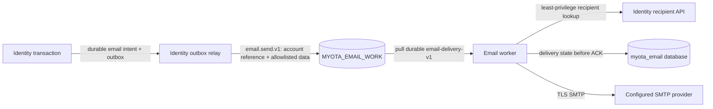

# Asynchronous email delivery

This page records the accepted target design and the current implementation
boundary for the email workstream. The target is **proposed** unless a section
explicitly labels a behavior current and links its evidence. No email worker is
deployed and no runtime path is authorized to send email yet.

## Current state

- The versioned `email.send.v1` contract defines the subject
  `myota.work.email.send.v1`, the proposed `MYOTA_EMAIL_WORK` WorkQueue stream,
  the `email-delivery-v1` pull durable, an 8 KiB envelope limit, and two
  allowlisted account-created templates. It excludes raw addresses, passwords,
  tokens, arbitrary HTML, and message bodies. See the canonical contract at
  [`contracts/schemas/work/email-send-v1.schema.json`](https://github.com/myota-platform/myota/blob/testing/contracts/schemas/work/email-send-v1.schema.json).
- PR [#82](https://github.com/myota-platform/myota/pull/82) is merged to
  `testing`. `apps/email/email_core.py` validates the bounded envelope,
  renders escaped text/HTML for the two templates, and requires TLS SMTP
  configuration. Its eight focused unit tests and the contract-source audit
  pass. This is a validation/rendering core, not a durable consumer.
- Identity's service-to-service recipient API and transactional email outbox,
  the NATS consumer, PostgreSQL delivery/idempotency state, retry/dead-letter
  behavior, SMTP Secret/ConfigMap deployment, and runtime telemetry are not
  implemented. The core cannot send on its own and is not deployed.

The workflow remains tracked by [myota #58](https://github.com/myota-platform/myota/issues/58)
and its component issues [#23](https://github.com/myota-platform/myota/issues/23),
[#25](https://github.com/myota-platform/myota/issues/25),
[#26](https://github.com/myota-platform/myota/issues/26),
[#27](https://github.com/myota-platform/myota/issues/27),
[#28](https://github.com/myota-platform/myota/issues/28), and
[#29](https://github.com/myota-platform/myota/issues/29). The implementation
owner is `myota` (`apps/email`, `contracts`, `deploy`, and `apps/identity`);
`myota-docs` owns this operating record and the former split repositories are
migration history, not live source owners.

## Accepted request and delivery path

Identity owns recipient addresses, eligibility, and the producer transaction.
The email worker resolves an account reference through an authenticated,
least-privilege Identity API; it must never query an Identity database. A
producer writes the stable work ID and email intent in the same transaction as
the selected account lifecycle change. Its relay publishes only after commit.
This outbox path depends on completion of the Identity database-authority work
in [#36](https://github.com/myota-platform/myota/issues/36).

The email worker owns rendering, SMTP interaction, delivery attempts, and
redacted recovery state in its own database. The queue transports bounded work
for a finite recovery window; it is not an email archive. If work expires from
JetStream, recovery starts from the producer's durable outbox and its stable
`workId`.

SMTP delivery is **at least once**. If the SMTP provider accepts a message and
the worker crashes before recording the accepted result, a retry can deliver a
duplicate. Neither the API nor operator procedure should claim exactly-once
delivery.

## Payload and template rules

The contract carries an Identity account UUID, a versioned template ID, and
bounded template data. It does not carry an email address. The initial
templates are `account-created-participant.v1` and
`account-created-administrator.v1`; their schemas are immutable once used. An
incompatible change requires a new template version. The worker rejects
unknown work versions, template IDs, or fields and does not treat rejection as
successful delivery.

Password-reset, recovery, and email-verification messages remain out of scope.
Their tokens are secret-bearing and need a separate one-time retrieval design.
The current non-enumerating recovery response must remain unchanged.

## SMTP configuration target

The target deployment keeps non-secret settings in a ConfigMap and only the
SMTP password in a Kubernetes Secret. These are proposed key names; Deploy
must implement and verify them before rollout.

| ConfigMap key | Purpose |
|---|---|
| `EMAIL_SMTP_HOST` | SMTP server hostname |
| `EMAIL_SMTP_PORT` | SMTP port |
| `EMAIL_SMTP_USERNAME` | SMTP account name |
| `EMAIL_SENDER_ADDRESS` | Sender address |
| `EMAIL_SENDER_DISPLAY_NAME` | Sender display name |
| `EMAIL_SMTP_TLS_MODE` | `starttls` or implicit TLS; plaintext is rejected |
| `EMAIL_SMTP_TIMEOUT_SECONDS` | Bounded connect/read timeout |

The password is injected as `EMAIL_SMTP_PASSWORD` from a named Secret key. Do
not put actual credentials or account values in Helm values, ConfigMaps, Git,
container images, issue comments, traces, logs, metrics, or health responses.
Compose must use a secret file or equivalent local secret store, not a checked-
in `.env` file. Test and production credentials must be separate. Rotation
replaces the Secret value and rolls only the email worker after a successful
Test verification.

## Queue and persistence proposal

The proposed stream uses WorkQueue retention with explicit pull ACKs, finite
message/byte/age bounds, bounded consumer replicas and pending ACKs, and a
finite retry/backoff policy. Do not derive capacity from an empty stream. Set
the numeric limits in [Deploy #23](https://github.com/myota-platform/myota/issues/23)
after measuring the intended test capacity and choosing the recovery window.
Keep the stream isolated from domain facts and other work queues.

The proposed `myota_email` database stores the stable `workId`, template ID,
bounded state and attempt counts, timestamps, and a redacted rejection code.
It must not retain recipient addresses, message bodies, template values,
credentials, or full broker payloads. ACK only after a completed delivery or a
durable retry/dead-letter decision. A redrive operation must require an
authorized operator, record actor/time/reason, and reuse the stable work ID.
Retention for delivery metadata and dead-letter records remains a Deploy
decision; choose the shortest period that supports the documented recovery
procedure and audit requirement.

## Operator procedure target

1. Check email durable pending count and oldest-message age, worker readiness,
   retry exhaustion, and SMTP connection/latency alerts. These metrics must use
   bounded outcome/template labels only.
2. For SMTP failure, preserve the queue and producer outbox. Restore the SMTP
   endpoint or rotate the Secret; do not purge the stream or replay arbitrary
   messages.
3. Inspect only redacted work IDs, state, attempt count, and rejection codes.
   Never print the raw NATS payload, resolved address, or message body.
4. For terminal failures, follow the audited redrive command after fixing the
   cause. Confirm the matching work ID and durable result before closing the
   recovery record.
5. If the bounded stream age expires, find the source intent by its stable work
   ID in Identity's outbox and republish under the approved replay procedure.
   Do not query another service's database from the email worker.

These steps are an operating proposal, not an available live runbook until
Deploy and service issues implement them. No SMTP credentials or actual message
data were used in PR #82 verification.

## Verification and remaining gates

PR #82 passed eight email-core unit tests, Ruff checks, the monorepo contract
tests, the workspace event-source audit (68 domain facts and 17 legacy work
source dispositions), and all reported PR checks. Tests covered both allowed
templates, rejection of addresses/tokens/arbitrary fields, the payload size
bound, HTML escaping, inactive-recipient rejection, bounded TLS configuration,
and STARTTLS-before-authentication ordering. No real SMTP request or NATS
publication occurred.

The workstream remains open until Identity producer/API authorization,
transactional outbox behavior, the JetStream durable consumer, database
idempotency/retry/DLQ, privacy-safe OpenTelemetry, Compose/Helm deployment,
Testing image publication, and operator recovery are implemented and verified.
