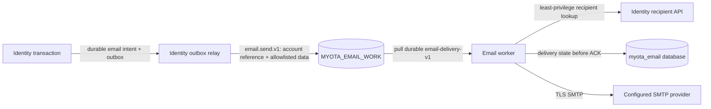

# Asynchronous email delivery

> **Current MyOTA Next configuration:** use the
> [outgoing email configuration guide](outgoing-email-configuration.md) for
> Helm values, Kubernetes Secret names and keys, SMTP TLS trust, and deployment
> checks. This page retains the accepted architecture and historical workstream
> record; snapshots below may predate the current monorepo implementation.

This page records the accepted design and current implementation boundary for
the email workstream. Runtime behavior is current only when merged and backed
by the evidence below. PR [#89](https://github.com/myota-platform/myota/pull/89)
merged to `testing` at `cd5b5189`. Its Testing image was published as
`ghcr.io/myota-platform/myota-email-service:testing-cd5b5189d150c41caff47170726aa28ff1959f48`
with digest `sha256:044cd063195f783495a9fa5271df4dc863bd2be6900f70513dc937ef16b0c319`.
The digest-sync workflow did not resolve or propose the digest because the
MyOTA-scoped GitHub App credentials are not configured. The worker is not
deployed, remains disabled in `myota-test`, and no runtime path is authorized
to send email yet.

The ownership and delivery decision is [ADR-0010](../../architecture/decisions/0010-asynchronous-email-delivery.md).

## Current state

- The versioned `email.send.v1` contract defines the subject
  `myota.work.email.send.v1`, the proposed `MYOTA_EMAIL_WORK` WorkQueue stream,
  the `email-delivery-v1` pull durable, an 8 KiB envelope limit, and two
  allowlisted account-created templates. It excludes raw addresses, passwords,
  tokens, arbitrary HTML, and message bodies. See the canonical contract at
  [`contracts/schemas/work/email-send-v1.schema.json`](https://github.com/myota-platform/myota/blob/testing/contracts/schemas/work/email-send-v1.schema.json).
- PR [#82](https://github.com/myota-platform/myota/pull/82) is merged to
  `testing`. `apps/email/email_core.py` validates the bounded envelope,
  renders escaped text/HTML for the two templates, and requires TLS SMTP
  configuration. Its eight focused unit tests and the contract-source audit
  pass. This is a validation/rendering core, not a durable consumer.
- PR [#83](https://github.com/myota-platform/myota/pull/83) adds the internal
  Identity recipient API and Gateway exclusion; it merged to `testing` after
  all PR checks passed. Runtime credential provisioning remains pending.
- PR #89 merged the worker source, isolated delivery-ledger schema, retry and
  redacted dead-letter handling, audited redrive command, Helm templates,
  bounded metrics, dashboard, and alerts to `testing`. The Testing image is
  published, but the digest has not been synchronized to the Helm release. The
  worker remains disabled; test SMTP/Identity/database Secrets and measured
  queue limits have not been provisioned.
- Identity's transactional email producer/outbox is not implemented. The
  worker's tests mock NATS, PostgreSQL, and Identity boundaries; real
  broker/database integration and `myota-test` runtime qualification remain
  outstanding. No feature-branch image is published; the `testing` image is
  published but not deployed.

The workflow remains tracked by [myota #58](https://github.com/myota-platform/myota/issues/58)
and its component issues [#23](https://github.com/myota-platform/myota/issues/23),
[#25](https://github.com/myota-platform/myota/issues/25),
[#26](https://github.com/myota-platform/myota/issues/26),
[#27](https://github.com/myota-platform/myota/issues/27),
[#28](https://github.com/myota-platform/myota/issues/28), and
[#29](https://github.com/myota-platform/myota/issues/29). The implementation
owner is `myota` (`apps/email`, `contracts`, `deploy`, and `apps/identity`);
`myota-docs` owns this operating record and the former split repositories are
migration history, not live source owners.

## Accepted request and delivery path



Identity owns recipient addresses, eligibility, and the producer transaction.
The email worker resolves an account reference through an authenticated,
least-privilege Identity API; it must never query an Identity database. A
producer writes the stable work ID and email intent in the same transaction as
the selected account lifecycle change. Its relay publishes only after commit.
This outbox path depends on completion of the Identity database-authority work
in [#36](https://github.com/myota-platform/myota/issues/36).

The email worker owns rendering, SMTP interaction, delivery attempts, and
redacted recovery state in its own database. The queue transports bounded work
for a finite recovery window; it is not an email archive. If work expires from
JetStream, recovery starts from the producer's durable outbox and its stable
`workId`.

SMTP delivery is **at least once**. If the SMTP provider accepts a message and
the worker crashes before recording the accepted result, a retry can deliver a
duplicate. Neither the API nor operator procedure should claim exactly-once
delivery.

## Payload and template rules

The contract carries an Identity account UUID, a versioned template ID, and
bounded template data. It does not carry an email address. The initial
templates are `account-created-participant.v1` and
`account-created-administrator.v1`; their schemas are immutable once used. An
incompatible change requires a new template version. The worker rejects
unknown work versions, template IDs, or fields and does not treat rejection as
successful delivery.

Password-reset, recovery, and email-verification messages remain out of scope.
Their tokens are secret-bearing and need a separate one-time retrieval design.
The current non-enumerating recovery response must remain unchanged.

## Recipient API implementation and deployment gate

PR [#83](https://github.com/myota-platform/myota/pull/83), merged to `testing`
at commit `d2250585b708ead209464f00ce864510ee9e1e16`, implements
`GET /v1/identity/internal/email-recipients/{accountId}` in the Identity owner
and its Deploy runtime mirror. It returns only `deliverableAddress` for an
active account with an address. Missing, pending-setup, deactivated, and
unaddressable accounts receive the same HTTP 404. Requests with participant,
administrator, or other service tokens are denied. The Gateway excludes
`/v1/identity/internal/`, and recipient/token responses disable caching.

The future worker exchanges `service=email-service` and a runtime
`MYOTA_EMAIL_SERVICE_CLIENT_SECRET` at
`POST /v1/identity/auth/service-token`. Identity issues a five-minute token
with subject `service:email-service`, audience `myota-identity`, and only
`identity.email.resolve`. The caller cannot choose scopes, and administrative
service-token issuance cannot grant that reserved scope. An absent or short
configured credential fails closed. Provision the same generated credential
into Identity and the worker through Kubernetes Secrets; do not place it in
ConfigMaps, Helm values, logs, or issue comments.

This API is a prerequisite, not a complete producer or deployment. Identity's
current JSONB/process snapshot remains its account lookup source until
[#36](https://github.com/myota-platform/myota/issues/36) makes relational reads
authoritative across replicas. Do not enable email publication before that
gate. Pending-setup accounts are deliberately ineligible; current account-
created templates alone do not authorize sending to them. The initial
participant trigger and any setup notification policy still require the
Identity lifecycle implementation. No SMTP or NATS requests were made by the
recipient API tests.

## SMTP configuration target

The Helm implementation submitted in PR #89 keeps non-secret settings in a
ConfigMap and SMTP/Identity credentials in Kubernetes Secrets. The worker is
disabled and has not been rolled out; Deploy must verify these references in
`myota-test` before enabling it.

| ConfigMap key | Purpose |
|---|---|
| `EMAIL_SMTP_HOST` | SMTP server hostname |
| `EMAIL_SMTP_PORT` | SMTP port |
| `EMAIL_SMTP_USERNAME` | SMTP account name |
| `EMAIL_SENDER_ADDRESS` | Sender address |
| `EMAIL_SENDER_DISPLAY_NAME` | Sender display name |
| `EMAIL_SMTP_TLS_MODE` | `starttls` or implicit TLS; plaintext is rejected |
| `EMAIL_SMTP_TIMEOUT_SECONDS` | Bounded connect/read timeout |

The password is injected as `EMAIL_SMTP_PASSWORD` from a named Secret key. Do
not put actual credentials or account values in Helm values, ConfigMaps, Git,
container images, issue comments, traces, logs, metrics, or health responses.
Use a secret manager or protected local files outside the checkout to stage
values. In `myota-test`, the current Helm configuration expects
`myota-email-runtime` keys `email-database-url`, `identity-client-secret`, and
`smtp-password`; the separate `myota-email-postgres-auth` Secret supplies
`username`, `password`, and `app-password`. Create or update these Secrets from
private files without placing values in shell arguments or history, then
enable the chart only after the queue-capacity gate and non-production SMTP
review pass. The Identity Deployment and worker both receive the same client
credential through Secret references. After rotating a value, roll the
affected Deployment so its environment is refreshed; coordinate PostgreSQL
role-password rotation with the database owner rather than treating it as an
SMTP credential change.

For K3s, stage individual values in permission-restricted files outside the
checkout and create the namespace-scoped runtime Secret through a pipe. Keep
shell tracing disabled so the generated Secret manifest is not printed:

```sh
kubectl -n myota-test create secret generic myota-email-runtime \
  --from-file=email-database-url=/secure/path/email-database-url \
  --from-file=identity-client-secret=/secure/path/identity-client-secret \
  --from-file=smtp-password=/secure/path/smtp-password \
  --dry-run=client -o yaml | kubectl apply -f -
```

Provision `myota-email-postgres-auth` separately with its three database role
keys from the approved secret manager. Do not paste values into a shell
argument, a Helm `--set`, a checked-in values file, or a command transcript.
The chart keeps email disabled until explicitly enabled; test Secret creation
alone does not start the worker.

The Compose source uses file-backed secrets selected by `EMAIL_DATABASE_URL_FILE`,
`MYOTA_EMAIL_SERVICE_CLIENT_SECRET_FILE`, and `EMAIL_SMTP_PASSWORD_FILE`; local
files must remain outside Git and `.env` files must not contain secret values.
This is source-level configuration guidance only. Under current repository
policy, deployment testing and qualification use Helm `myota-test`; do not run
Compose or Podman deployment checks. Keep test and production secret-manager
entries, SMTP accounts, and recipient fixtures separate. Rotate SMTP credentials
at the provider, update only the relevant Secret, roll the email worker, and
verify the non-production connection before considering any production
configuration change.

## Queue and persistence proposal

The submitted worker expects WorkQueue retention with explicit pull ACKs,
finite message/byte/age bounds, one pull consumer, and bounded retries. Its
Helm provisioner requires operator-supplied limits and an explicit capacity
review gate; no default capacity is invented. Do not derive capacity from an
empty stream. Set the numeric limits in [Deploy #23](https://github.com/myota-platform/myota/issues/23)
after measuring the intended test capacity and choosing the recovery window.
Keep the stream isolated from domain facts and other work queues.

The schema submitted in PR #89 stores the stable `workId`, template ID,
bounded state and attempt counts, timestamps, and a redacted rejection code.
It does not retain recipient addresses, message bodies, template values,
credentials, or full broker payloads. The worker commits a delivered, retry, or
dead-letter outcome before ACK/NAK/termination. Its `redrive` command records
actor, reason, and time, and requires the producer to replay the same stable
work ID. Database integration, access controls for the command, and retention
limits still need review and runtime qualification.

## Operator procedure target

1. Check email durable pending count and oldest-message age, worker readiness,
   retry exhaustion, and SMTP connection/latency alerts. These metrics must use
   bounded outcome/template labels only.
2. For SMTP failure, preserve the queue and producer outbox. Restore the SMTP
   endpoint or rotate the Secret; do not purge the stream or replay arbitrary
   messages.
3. Inspect only redacted work IDs, state, attempt count, and rejection codes.
   Never print the raw NATS payload, resolved address, or message body.
4. For terminal failures, follow the audited redrive command after fixing the
   cause. Confirm the matching work ID and durable result before closing the
   recovery record.
5. If the bounded stream age expires, find the source intent by its stable work
   ID in Identity's outbox and republish under the approved replay procedure.
   Do not query another service's database from the email worker.

These steps describe the intended recovery workflow; they are not yet a
qualified live runbook. PR #89 includes the redrive command interface, but
operators must not invoke it until access controls and the full delivery path
have been qualified. No SMTP credentials or real message data were used in
worker tests.

## Verification and remaining gates

PR #82 passed eight email-core unit tests, Ruff checks, the monorepo contract
tests, the workspace event-source audit (68 domain facts and 17 legacy work
source dispositions), and all reported PR checks. Tests covered both allowed
templates, rejection of addresses/tokens/arbitrary fields, the payload size
bound, HTML escaping, inactive-recipient rejection, bounded TLS configuration,
and STARTTLS-before-authentication ordering. No real SMTP request or NATS
publication occurred.

PR #89's functional-code head `4719813` passed the 20-test worker suite (fake SMTP and
mocked Identity/NATS/store boundaries), six deployment checks, 14 JetStream
topology checks, 19 observability checks, 12 Contracts tests, Ruff, Helm lint,
and all required PR CI jobs, including email image build, contract, chart, and
repository-level tests. PR #89 merged to `testing` at `cd5b5189`; testing push
run [38705095802](https://github.com/myota-platform/myota/actions/runs/38705095802)
passed validation/build and published the immutable Testing image digest listed
above. Digest-sync run
[38705309558](https://github.com/myota-platform/myota/actions/runs/38705309558)
completed without resolving a digest because the MyOTA-scoped GitHub App
credentials are not configured. These checks do
not prove real PostgreSQL/NATS integration, live collector data, actual SMTP
delivery, or Helm deployment behavior. One unrelated monorepo CI job was still
pending at the time of the PR update. Feature and PR builds do not publish an
image; only a successful push to `testing` publishes the Testing image.

The workstream remains open until the Identity producer/outbox and its database
authority are implemented, the worker and topology pass real integration
checks, measured queue limits and test-only credentials are provisioned, the
worker is qualified in Helm `myota-test`, the published Testing image digest is
synced and rolled out, and the operator recovery path is exercised. Per the
repository instruction, deployment testing and qualification use the Helm
Testing release; no Compose or Podman deployment tests are run.
